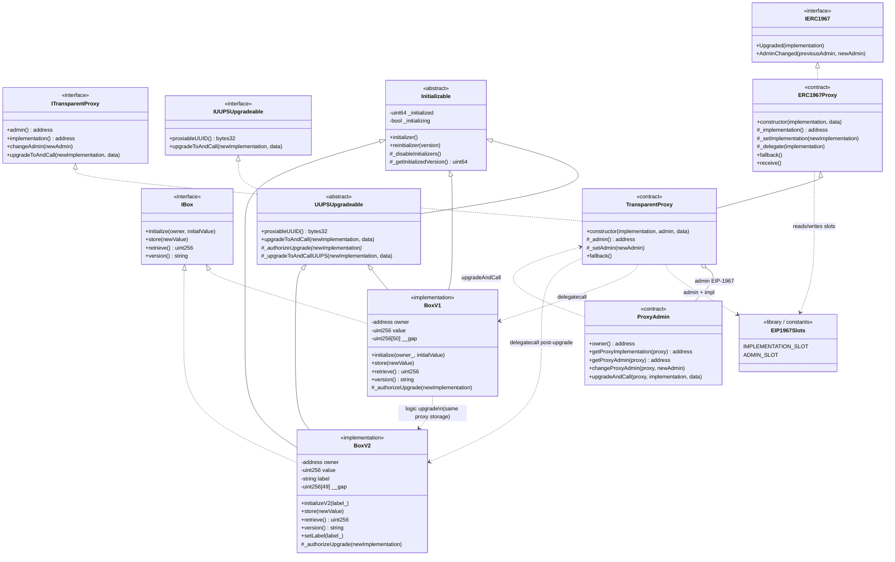

# Class diagram — Upgradeable Proxies (UUPS & Transparent)

> 🌐 **English** · [Español](./diagrama-de-clases-ES.md) · [Index](../README.md)

Structural view of contracts, interfaces, and relationships (module 11).

## Diagram (Mermaid)

## Key relationships

| From | To | Type | Reason |
|-------|-------|------|--------|
| `ERC1967Proxy` | Implementation | Dependency (delegatecall) | Executes logic in the proxy's storage context |
| `TransparentProxy` | `ProxyAdmin` | Association (admin slot) | Only the admin manages upgrades / changeAdmin |
| `ProxyAdmin` | `TransparentProxy` | Dependency | Calls `upgradeToAndCall` as `msg.sender == admin` |
| `BoxV1` / `BoxV2` | `UUPSUpgradeable` | Inheritance | Upgrade authorization lives in the logic |
| `BoxV*` | `Initializable` | Inheritance | Prevents re-init and disables constructors that would be useful via proxy |
| `BoxV1` → `BoxV2` | — | Layout compatibility | New variables only at the end; reduced `__gap` |

## Design notes

1. **Two upgrade paths**: Transparent (admin in the proxy) vs UUPS (authorization in the impl).
2. **Proxy storage ≠ deployed impl storage**: state lives at the proxy's address.
3. **`__gap`**: reserves slots in base/impl contracts for future extensions without collisions.
4. **Function clash (Transparent)**: if `msg.sender` is the admin, user selectors are not delegatecalled.
5. **OZ v5**: audited primitives can be inherited; the semantics must comply with EIP-1967 and the module's custom errors.
