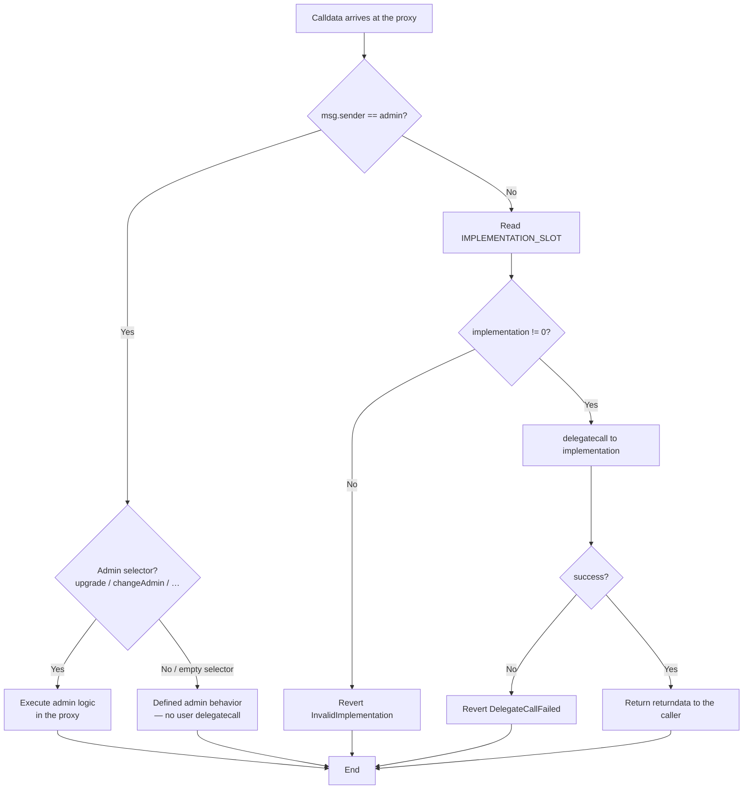
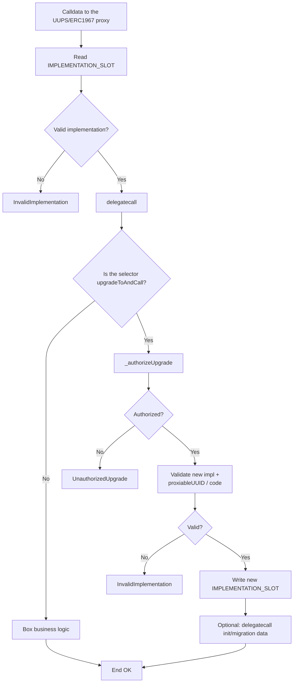
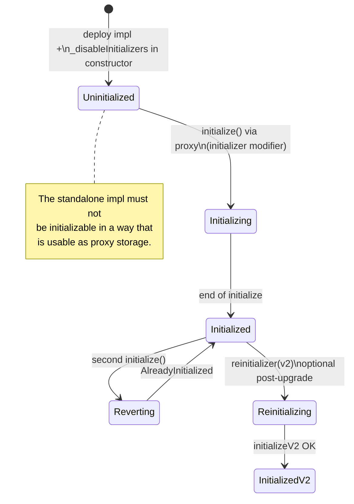
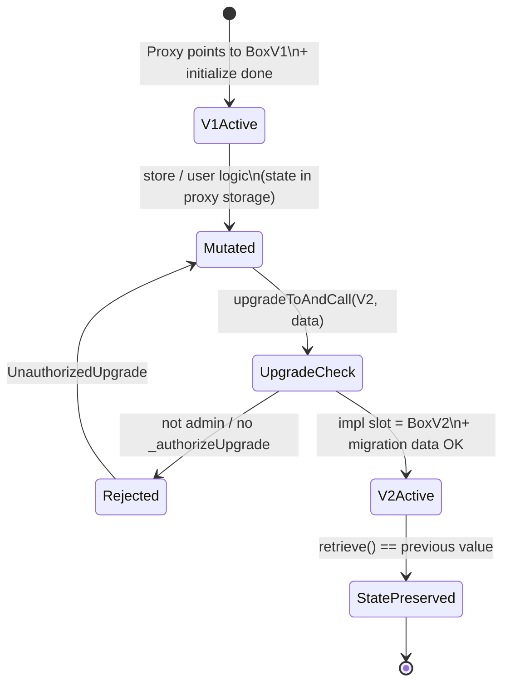

# Flow Diagram — Routing, Initialization and Upgrade

> 🌐 **English** · [Español](./diagrama-de-flujo-ES.md) · [Index](../README.md)

Internal decision flows of the proxy system (module 11).

## 1. Transparent Proxy Routing (fallback)

## 2. UUPS Routing (user always delegatecalls)

## 3. Initialization (`Initializable`)

## 4. Upgrade Lifecycle (both patterns)

## 5. Decision / Error Table

| Situation | Condition | Result | Error |
|-----------|-----------|-----------|--------|
| Delegatecall to `address(0)` | invalid impl | revert | `InvalidImplementation` |
| `delegatecall` fails | success == false | revert | `DelegateCallFailed` |
| Re-init | `_initialized` already set | revert | `AlreadyInitialized` |
| Upgrade without permission | unauthorized caller | revert | `UnauthorizedUpgrade` |
| Upgrade to impl without code / bad UUID | UUPS/ERC1967 check | revert | `InvalidImplementation` |
| User on Transparent | `msg.sender != admin` | delegatecall | — |
| Admin on Transparent | `msg.sender == admin` | admin path | — |

## Invariants

1. The **business state** lives at the **proxy** address; it never “moves” when the impl changes.
2. All user logic execution goes through **`delegatecall`**.
3. An upgrade does **not** re-run V1's `initialize`; migrations use `reinitializer` or `upgradeToAndCall` calldata.
4. The V2 layout does **not reorder or reuse** slots already occupied by V1.
