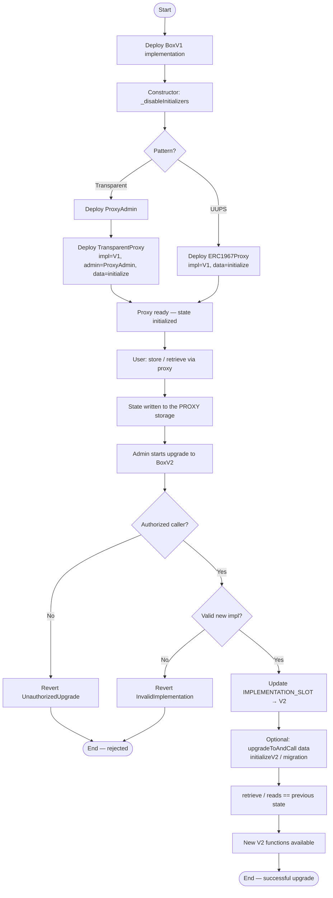
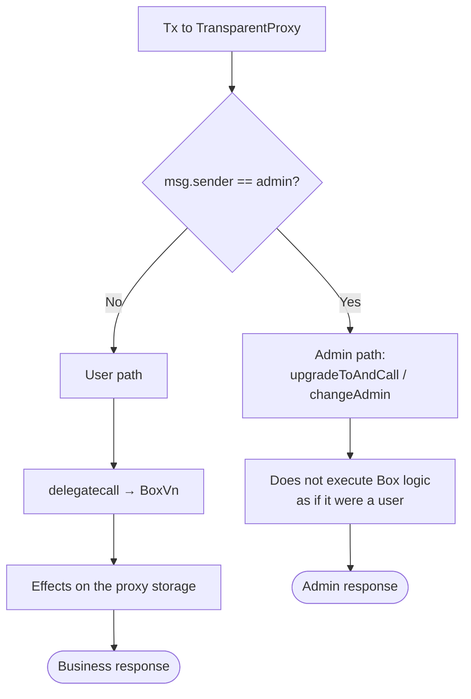
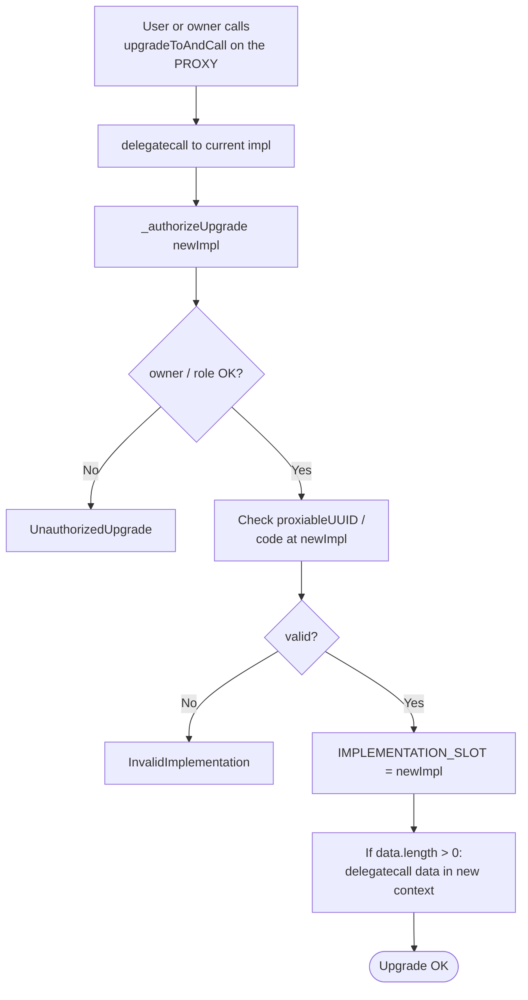
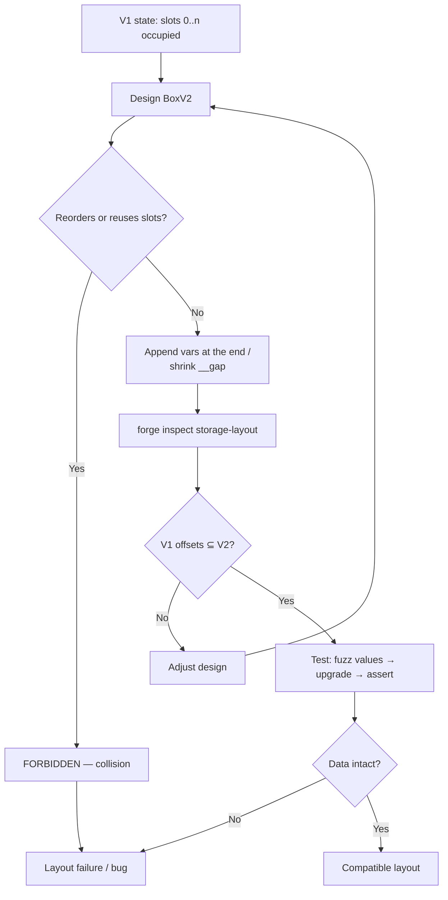
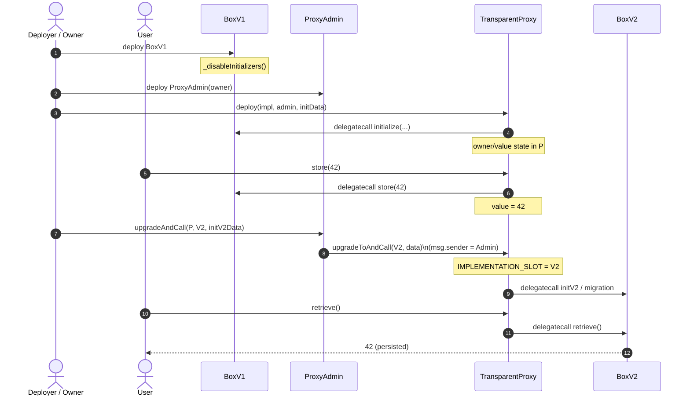
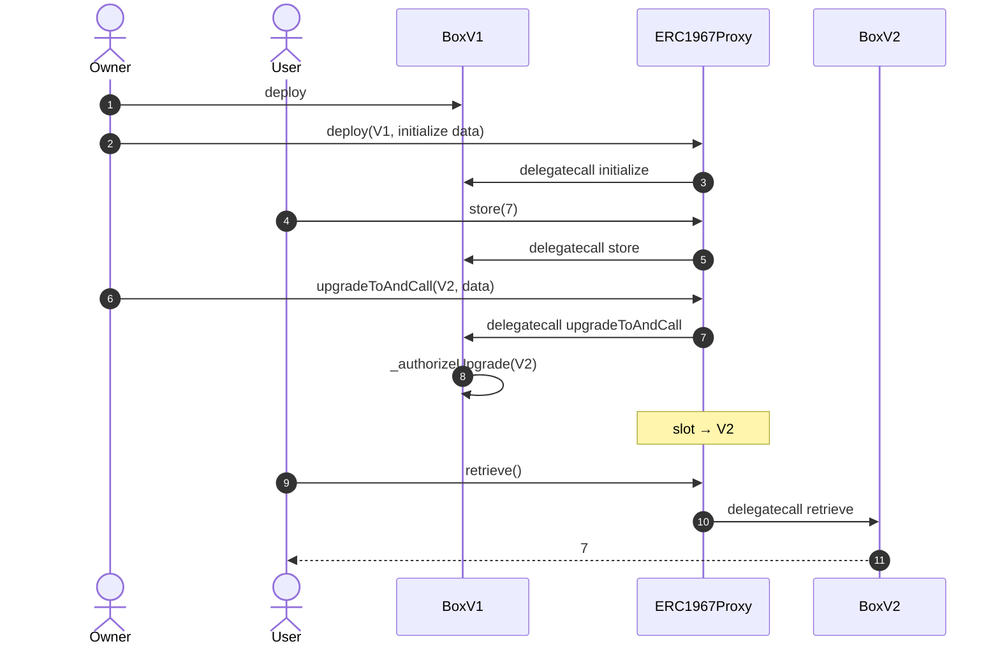

# Flowchart — Full lifecycle of upgradeable proxies

> 🌐 **English** · [Español](./flujograma-ES.md) · [Index](../README.md)

End-to-end flow between actors and contracts: deployment, usage, upgrade, and persistence verification.

## Actors

| Actor | Role |
|-------|-----|
| Deployer | Deploys impl, proxy and (if applicable) `ProxyAdmin` |
| Owner / Admin | Authorizes upgrades (`ProxyAdmin.owner` or `_authorizeUpgrade`) |
| User | Calls business functions through the proxy |
| Proxy | Stores EIP-1967 slots; routes with `delegatecall` |
| Implementation V1 / V2 | Logic; compatible storage layout |
| Tester / CI | Foundry: unit, unauthorized, fuzz, `forge inspect` |

---

## Main flowchart — Deploy → Use → Upgrade → Verify

---

## Transparent flowchart — admin vs user

---

## UUPS flowchart — authorization in the logic

---

## Storage anti-corruption flowchart

---

## Sequence — Transparent (example)

---

## Sequence — UUPS (example)

---

## Operational summary

1. **Deploy the impl** always with initializers disabled in the constructor.
2. **Initialize only via the proxy** (proxy constructor calldata or a controlled later call).
3. **The user talks to the proxy** and never needs to know the impl address (except for operations/ops).
4. **Upgrade = changing an EIP-1967 slot** (+ authorization); business storage remains intact.
5. **Foundry tests** must walk through this flowchart and the `UnauthorizedUpgrade`, `AlreadyInitialized`, `InvalidImplementation`, `DelegateCallFailed` paths.
